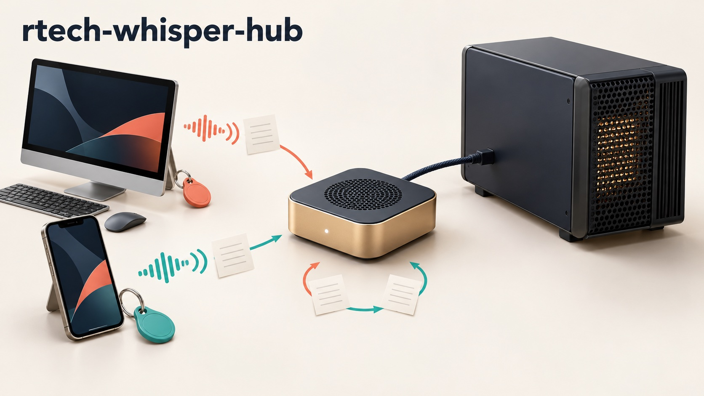
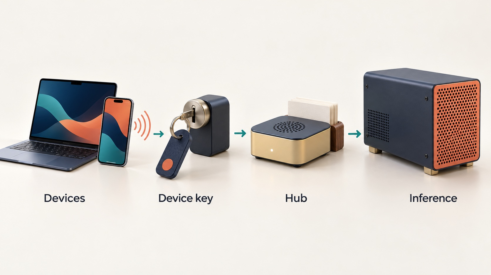
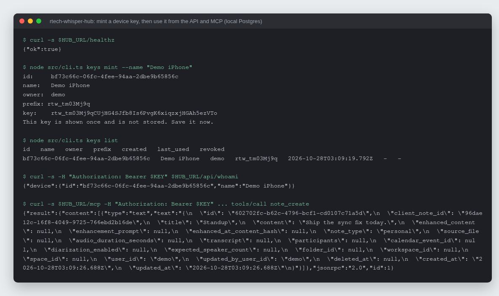

# rtech-whisper-hub

The self-hosted server behind rTech Whisper: device keys, note and history
sync, and a relay to your own speech and language models, for a desktop
dictation app and its iPhone companion.

[](https://github.com/rodaddy/rtech-whisper-hub/actions/workflows/ci.yml)
[](LICENSE)




## What it is

rtech-whisper-hub is the backend half of rTech Whisper. Two clients talk to
it: the desktop app (the `rtech-whisper` branch of
[rodaddy/openwhispr](https://github.com/rodaddy/openwhispr), a fork of
[OpenWhispr](https://github.com/OpenWhispr/openwhispr)) and the native
[iPhone app](https://github.com/rodaddy/rtech-whisper-ios). It does four jobs:

- issues per-device API keys;
- syncs notes, folders, dictionary words, snippets and transcriptions between
  devices, using the sync protocol of upstream OpenWhispr's personal scope;
- relays speech-to-text, voice synthesis and OpenAI-style chat completions to
  an inference host you run (llama-swap or anything OpenAI-compatible);
- serves a remote MCP endpoint so coding agents (Claude Code, Codex) can read
  and write notes.

TypeScript on Node 24 (native type stripping, no build step), Hono, Drizzle
and Postgres.

## Why it exists

OpenWhispr's own sync server is not public, and its phone client is tied to
its cloud. This hub reimplements the subset the clients need, so one person's
devices share notes and reach a home inference box through one authenticated
URL, at home or away, without sending audio or notes to a third-party service.

## How it works



Every `/api` request carries a device key; only its SHA-256 hash and prefix
are stored, and each key and every synced row belongs to one owner. Sync
(`src/sync/`) follows upstream's pull/push model: the hub stamps each write,
clients pull deltas from a cursor taken at the start of a pass minus a 60 s
lookback, and a stamp budget aborts any write that would commit too late for
that lookback to see it. The voice relay (`src/voice/`) trims silence, cuts
long audio into chunks, merges the transcripts, and shares one GPU semaphore
with rate and in-flight limits; synthesis uses a server-side reference clip.
The LLM relay (`src/llm/`) forwards OpenAI-style chat completions with a
model allowlist. The wire contract is [docs/protocol.md](docs/protocol.md),
and every place it differs from upstream is listed in its divergence table.



*Real output: the hub running locally against a throwaway Postgres; a key
minted with the CLI, then used for `/api/whoami` and the MCP `note_create`
tool. The database was deleted afterwards.*

## Features

- Per-device keys (`rtw_` + 43 base64url chars), minted and revoked through
  admin routes and a small CLI.
- Sync for five kinds (notes, folders, dictionary, snippets, transcriptions)
  with cursors, tombstones and per-owner row isolation.
- Speech-to-text relay with silence trim, chunking, repeated-sentence collapse,
  rate limits and a shared GPU semaphore.
- Voice synthesis relay in the desktop's OmniVoice shape, plus an
  OpenAI-shaped `/v1/audio/speech` route, voices list and discovery document.
- LLM relay with a model allowlist and streamed responses.
- Remote MCP server over Streamable HTTP: list, search, get, create and
  update notes, list folders and transcriptions; no delete tool.
- Forward-only Drizzle migrations that run on startup.

## Quick start

With Docker:

```sh
git clone https://github.com/rodaddy/rtech-whisper-hub.git
cd rtech-whisper-hub
cp env.example .env               # fill in POSTGRES_PASSWORD and HUB_ADMIN_TOKEN
cp docker-compose.example.yml docker-compose.yml
docker compose up --build
curl http://localhost:8096/healthz
```

Without containers, against a Postgres you already have (Node 24):

```sh
npm ci
DATABASE_URL=postgres://... HUB_ADMIN_TOKEN=$(openssl rand -hex 32) npm start
```

Then mint a key for a device:

```sh
export HUB_URL=http://localhost:8096 HUB_ADMIN_TOKEN=...
node src/cli.ts keys mint --name "My iPhone"
```

Tests (typecheck plus the full suite; PGlite runs Postgres in process and the
upstreams are fakes, so no database server or GPU is needed):

```sh
npm ci && npm run check
```

## Reference

### Environment

| Variable | Required | Default | Meaning |
| --- | --- | --- | --- |
| `HUB_PORT` | no | `8096` | HTTP listen port (1-65535) |
| `DATABASE_URL` | yes | - | Postgres URL (`postgres://` or `postgresql://`) |
| `HUB_ADMIN_TOKEN` | yes | - | Bearer token for the `/admin` routes, at least 32 chars |
| `HUB_OWNER_ID` | no | `rico` | Owner a new device key gets when the mint names none |
| `LOG_LEVEL` | no | `info` | pino log level |
| `VOICE_UPSTREAM_URL` | no | `http://localhost:8080` | Inference host root for speech-to-text and synthesis |
| `VOICE_UPSTREAM_API_KEY` | no | - | Sent upstream as a bearer token |
| `VOICE_STT_MODEL` | no | `whisper-large-v3-turbo` | Speech-to-text model id |
| `VOICE_PROFILE_DIR` | no | - | Directory with `ref.wav` and `ref.txt`, the server voice |
| `LLM_UPSTREAM_URL` | no | `VOICE_UPSTREAM_URL` | Root for the LLM relay |
| `LLM_UPSTREAM_API_KEY` | no | - | Bearer for the LLM relay upstream |
| `LLM_MODEL_ALLOWLIST` | no | all | Comma-separated model ids the relay accepts |

The default owner id `rico` is the author's; set `HUB_OWNER_ID` to any id you
like. Migration 0002 backfills rows that existed before owners to `rico`, and
the migration runs forward only.

The server voice has the fixed id `skippy` in the speech API (protocol
section 10). No voice clip ships in this repo: bring your own reference recording
and its transcript. Without one, synthesis requests that carry no voice of
their own get a 503.

### Routes

| Route                                       | Auth                                      | Response                                                                                                 |
| ------------------------------------------- | ----------------------------------------- | -------------------------------------------------------------------------------------------------------- |
| `GET /healthz`                              | none                                      | `200 {"ok":true}` or `503 {"ok":false}`                                                                  |
| `GET /api/whoami`                           | `Authorization: Bearer <device key>`      | `200 {"device":{"id","name"}}` or `401`                                                                  |
| `POST /admin/devices`                       | `Authorization: Bearer <HUB_ADMIN_TOKEN>` | body `{"name":"..."}` (1-100 chars) -> `201 {"device":{"id","name","prefix"},"key":"rtw_..."}`, or `400` |
| `GET /admin/devices`                        | `Authorization: Bearer <HUB_ADMIN_TOKEN>` | `200 {"devices":[{"id","name","prefix","created_at","last_used_at","revoked_at"}]}`                      |
| `POST /admin/devices/<id-or-prefix>/revoke` | `Authorization: Bearer <HUB_ADMIN_TOKEN>` | `200 {"revoked":true}`, or `404` when no active device matched                                           |

Errors are `{"error":{"message":...},"code":...}` with code `unauthorized`
(401), `invalid_request` (400), or `not_found` (404). A device key never
passes admin auth, and the admin token never passes `/api` auth. Admin request
log lines carry `"admin":true` and never the token, the minted key, or bodies.

### Device keys
Keys are `rtw_` plus 43 base64url characters. Only a SHA-256 hash and the
12-character prefix are stored; the plaintext key appears once, in the mint
response.

Manage keys with the CLI, which calls the admin routes:

```sh
export HUB_URL=https://hub.example.internal   # default http://localhost:8096
export HUB_ADMIN_TOKEN=...
node src/cli.ts keys mint --name "My iPhone"
node src/cli.ts keys list
node src/cli.ts keys revoke <id-or-prefix>
```

A non-2xx response prints the status and error message to stderr and exits 1;
wrong usage or a missing `HUB_ADMIN_TOKEN` exits 2. Put `/admin/*` behind your
own SSO or keep it off the public route.

### MCP

`POST /mcp` serves the desktop `rtw` tools over Streamable HTTP (stateless,
JSON responses), behind the same device-key auth as `/api`. Tools:
`notes_list`, `notes_search`, `note_get`, `note_create`, `note_update`,
`folders_list`, `transcriptions_list`. There is no delete tool. `note_update`
takes an optional `base_updated_at`; if the note changed since, the result is
an error `CONFLICT: ...` carrying the current `updated_at`.

Mint one device key per agent host, then:

```sh
claude mcp add --transport http rtech-whisper-hub \
  https://hub.example.internal/mcp \
  --header "Authorization: Bearer <device key>"

export RTW_HUB_KEY=<device key>
codex mcp add rtech-whisper-hub \
  --url https://hub.example.internal/mcp \
  --bearer-token-env-var RTW_HUB_KEY
```

### What it does not do

- No user accounts, sharing, invitations, or the team features of upstream
  OpenWhispr's cloud (see the protocol's out-of-scope list).
- No speech or language models of its own; it relays to a host you run.
- No TLS termination; run it behind a reverse proxy, and keep `/admin/*`
  behind your own SSO or off the public route.
- No deploy tooling beyond the example Dockerfile and compose file.

## How it was built

The hub went from an empty repository to a working sync, voice and MCP server
on 2026-09-29, built by AI coding agents in parallel lanes against a written
protocol, then hardened through review rounds over the following days. The
phases, the protocol decisions and what review changed are in
[docs/BUILD-STORY.md](docs/BUILD-STORY.md).

## Project status

Experimental, version 0.1.0. It runs on its author's own desktop and
iPhone, behind a reverse proxy with SSO in front of `/admin` (that proxy
configuration is not part of this repo). It has no other known deployments.
There is no multi-tenant hardening beyond per-owner row isolation, no web UI
and no account system: an admin mints keys.

## Credits

- [OpenWhispr](https://github.com/OpenWhispr/openwhispr), whose personal-scope
  sync protocol the hub reimplements.
- [Hono](https://hono.dev), [Drizzle ORM](https://orm.drizzle.team),
  [PGlite](https://pglite.dev) for in-process test databases, and the
  [MCP TypeScript SDK](https://github.com/modelcontextprotocol/typescript-sdk).

## Licence

MIT. See [LICENSE](LICENSE).

## Author

Rico Rojas, https://rico-rojas.com
